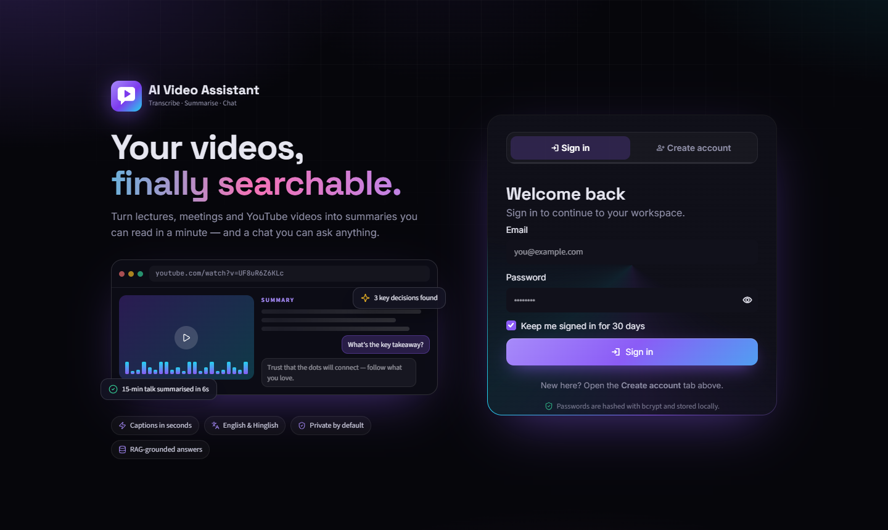
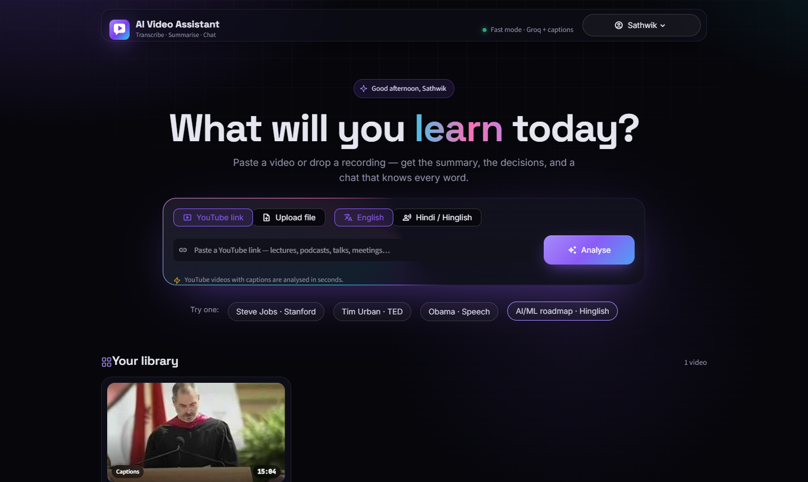
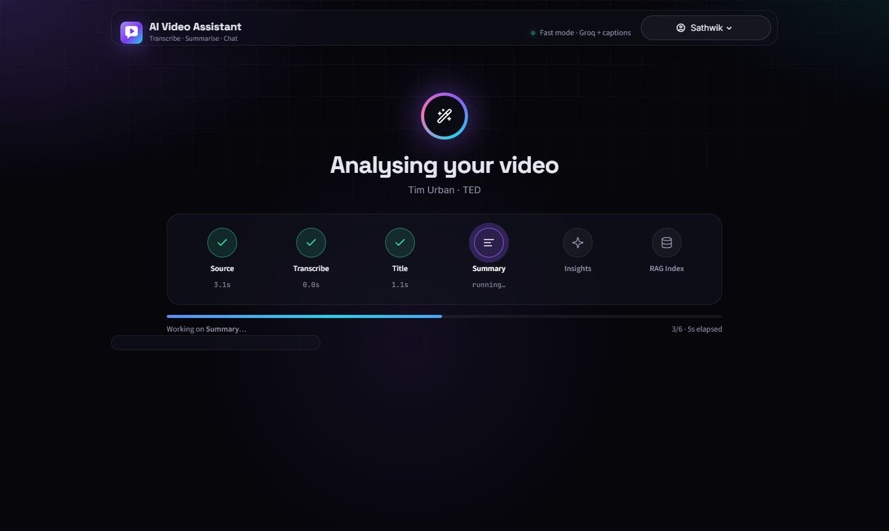
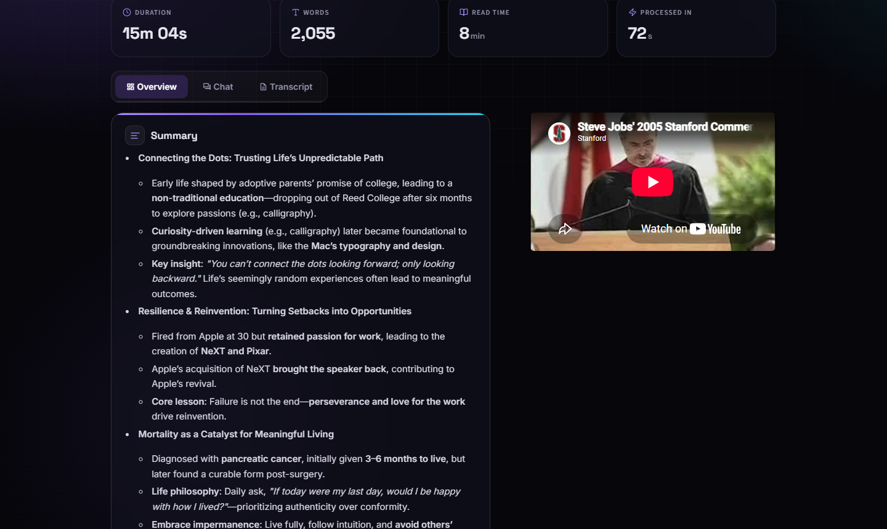
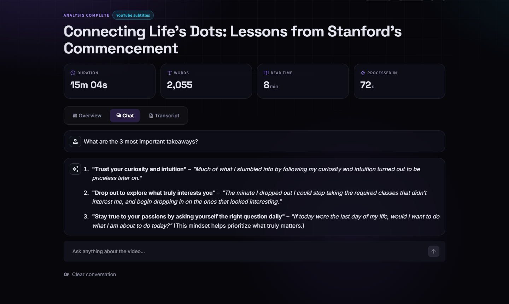
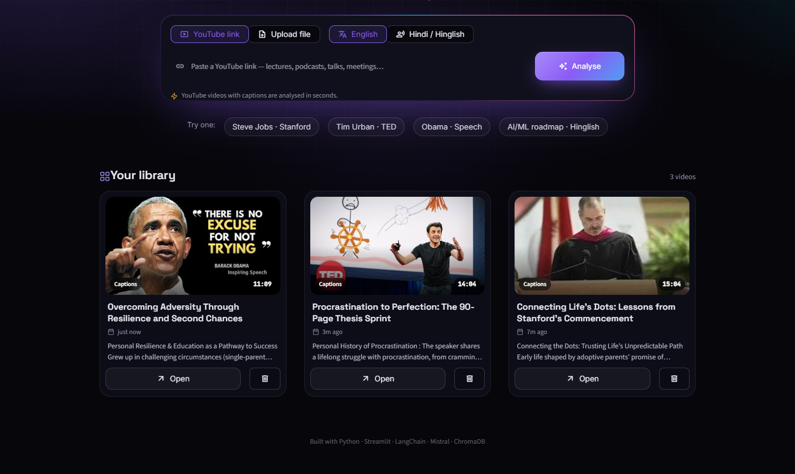
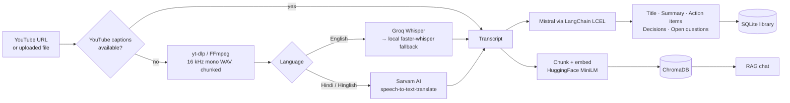

<div align="center">


# AI Video Assistant

**Turn any video into answers you can chat with.**

Paste a YouTube link or upload a recording. Get a transcript, a structured summary, action items,
key decisions and open questions, then ask the video anything with Retrieval-Augmented Generation (RAG).


[](https://ai-video-assistant-with-rag-enhylzyarkuexzqkhky3hc.streamlit.app/)

**Live app:** [ai-video-assistant-with-rag-enhylzyarkuexzqkhky3hc.streamlit.app](https://ai-video-assistant-with-rag-enhylzyarkuexzqkhky3hc.streamlit.app/)

</div>

---

## Table of contents

- [Overview](#overview)
- [Screenshots](#screenshots)
- [Features](#features)
- [How it works](#how-it-works)
- [Tech stack](#tech-stack)
- [Project structure](#project-structure)
- [Getting started](#getting-started)
- [Configuration](#configuration)
- [Usage](#usage)
- [Data & privacy](#data--privacy)
- [Troubleshooting](#troubleshooting)
- [Limitations & ideas](#limitations--ideas)

---

## Overview

Long videos are hard to search. Lectures, podcasts, meetings and talks hold useful information, but finding
one specific point means scrubbing through the whole thing.

**AI Video Assistant** turns a video into a short, searchable report you can talk to:

1. **Transcribes** the video in the fastest way available: YouTube's own captions, cloud Whisper on Groq,
   or local Whisper. Hindi and Hinglish speech is transcribed and translated to English by Sarvam AI.
2. **Analyses** the transcript with an LLM (Mistral via LangChain) to produce a title, a summary, action items
   (with owners and deadlines), key decisions and open questions.
3. **Indexes** the transcript in a vector database (ChromaDB) so you can **chat with the video**. Every answer
   is grounded only in what was actually said.
4. **Saves** each analysis to your personal library, so you can reopen it any time or export it as PDF or TXT.

It runs locally as a Streamlit web app with user accounts. There's also a command-line version.

## Screenshots

| Sign in | Home |
|---|---|
|  |  |

| Processing | Results |
|---|---|
|  |  |

| Chat with the video (RAG) | Your library |
|---|---|
|  |  |

## Features

### Transcription that picks the fastest route
| Input | Engine | Typical speed |
|---|---|---|
| YouTube link with captions | YouTube subtitles / auto-captions (no audio download) | **~5 s** for a 15-min video |
| English audio (no captions, or an uploaded file) | **Groq** Whisper large-v3-turbo (cloud) | ~10–30 s per hour of audio |
| No Groq key, or Groq is unavailable | **faster-whisper** (local, CPU, int8) | Slower; works offline |
| Hindi / Hinglish | **Sarvam AI** speech-to-text-translate | Cloud; outputs English |

If Groq hits a rate limit partway through, the remaining chunks fall back to local Whisper automatically.
If local Whisper runs out of memory, it steps down to a smaller model (`small` → `base` → `tiny`).

### AI analysis
- **Title**: a short, professional title generated from the transcript.
- **Summary**: map-reduce summarisation, so it works even on multi-hour videos.
- **Action items**: tasks with owner and deadline (when mentioned).
- **Key decisions** and **open questions / follow-ups**.

### Chat with your video (RAG)
- The transcript is split into chunks, embedded with `all-MiniLM-L6-v2` and stored in ChromaDB.
- Each question retrieves the most relevant chunks and Mistral answers **only from that context**.
  If the answer isn't in the video, it says so.
- Suggested starter questions, and a separate vector collection per video so answers never mix
  across videos.

### App experience
- **Accounts**: sign up / sign in, passwords hashed with **bcrypt**, and an optional
  "keep me signed in for 30 days" session cookie.
- **Personal library**: every analysis is saved with its thumbnail, engine, duration and summary preview.
  Open or delete (with confirmation) at any time.
- **Live pipeline tracker**: six steps (Source → Transcribe → Title → Summary → Insights → RAG index)
  with per-step timings.
- **Results dashboard**: duration, word count, read time and processing time, plus the embedded video,
  colour-coded insight cards and a searchable transcript with highlighted matches.
- **Export**: download a PDF or TXT report (summary, insights, chat and full transcript).
- **Design**: dark glass UI, animated aurora background, cursor spotlight, glowing command bar,
  custom SVG icons and logo.

## How it works



**Pipeline in detail**

1. **Source** (`core/transcript_source.py`): for YouTube links, `utils/captions.py` asks yt-dlp for caption
   tracks. It prefers creator subtitles, then English auto-captions. If none fit, `utils/audio_processor.py`
   downloads the audio, converts it to 16 kHz mono WAV and splits it into 10-minute chunks.
2. **Transcribe** (`core/transcriber.py`): routes chunks to Sarvam AI (Hinglish), Groq (English, if
   `GROQ_API_KEY` is set) or local faster-whisper.
3. **Title & summary** (`core/summarizer.py`): the summary splits the transcript into ~3,000-character chunks,
   summarises them in parallel (map), then merges the partial summaries (reduce).
4. **Insights** (`core/extractor.py`): three LCEL chains (action items, decisions, questions) run in parallel
   with `RunnableParallel`.
5. **RAG index** (`core/vector_store.py`, `core/rag_engine.py`): 500-character chunks are embedded and stored
   in a ChromaDB collection named after a hash of the transcript, so re-opening a video reuses the index.
6. **Save** (`core/history.py`): the result is stored in SQLite under your account.

All LLM calls go through one shared Mistral client (`core/llm.py`) with a rate limiter and automatic retries,
so free-tier limits don't break the pipeline.

## Tech stack

| Layer | Tools |
|---|---|
| UI | Streamlit 1.59, custom CSS, inline SVG icons |
| LLM | Mistral AI (`ministral-14b-latest` by default) via `langchain-mistralai` |
| Orchestration | LangChain LCEL (`RunnableParallel`, `RunnablePassthrough`, prompt templates) |
| Transcription | YouTube captions (yt-dlp), Groq Whisper large-v3-turbo, faster-whisper (CTranslate2), Sarvam AI |
| Embeddings | HuggingFace `sentence-transformers/all-MiniLM-L6-v2` (local, free) |
| Vector DB | ChromaDB (persistent, local) |
| Media | yt-dlp (+ yt-dlp-ejs with Node.js), FFmpeg, pydub |
| Storage & auth | SQLite, bcrypt, SHA-256-hashed session tokens |
| Export | fpdf2 (PDF), plain text |

## Project structure

```
AI-Video-Assistant-With-RAG/
├── app.py                    # Streamlit app: auth gate, home, processing, results, library
├── main.py                   # Command-line version of the pipeline
├── test.py                   # Quick end-to-end check
├── requirements.txt
├── .env.example              # Template for your API keys
├── .streamlit/config.toml    # Theme + server settings
├── assets/                   # Logo (SVG + PNG favicon)
├── docs/screenshots/         # Images used in this README
├── core/
│   ├── transcript_source.py  # Chooses captions → Groq → local Whisper / Sarvam
│   ├── transcriber.py        # Groq, faster-whisper and Sarvam AI transcription
│   ├── summarizer.py         # Title + map-reduce summary
│   ├── extractor.py          # Action items, key decisions, open questions
│   ├── vector_store.py       # ChromaDB + HuggingFace embeddings
│   ├── rag_engine.py         # Retrieval-augmented chat chain
│   ├── llm.py                # Shared Mistral client (rate limiting + retries)
│   ├── auth.py               # Accounts and login sessions (SQLite + bcrypt)
│   └── history.py            # Per-user library of saved analyses
├── utils/
│   ├── audio_processor.py    # YouTube download, WAV conversion, chunking
│   ├── captions.py           # YouTube caption fetching and parsing
│   └── exporter.py           # PDF / TXT report export
└── ui/
    ├── style.css             # Design system, animations, layout
    ├── auth_page.py          # Sign-in / sign-up page with animated preview
    ├── session.py            # "Keep me signed in" cookie handling
    ├── icons.py              # SVG icon set + logo
    └── effects.py            # Cursor spotlight effect
```

## Getting started

### Try it online

The app is deployed on Streamlit Community Cloud: **[open the live demo](https://ai-video-assistant-with-rag-enhylzyarkuexzqkhky3hc.streamlit.app/)**.
Create an account and click one of the **"Try one"** examples. No setup needed.

> The demo runs on free hosting: accounts and the library reset when the app restarts, and YouTube may block
> downloads from cloud servers. If a YouTube link fails, use **Upload file** instead.

To run it on your own machine, follow the steps below.

### Prerequisites

- **Python 3.12**
- **FFmpeg** on your `PATH`, for audio conversion ([download](https://ffmpeg.org/download.html))
- **Node.js**: yt-dlp uses it to solve YouTube's download challenge ([download](https://nodejs.org))
- API keys:
  - **Mistral** (required): free at [console.mistral.ai](https://console.mistral.ai)
  - **Groq** (recommended): free at [console.groq.com](https://console.groq.com)
  - **Sarvam AI** (optional, for Hindi/Hinglish): [dashboard.sarvam.ai](https://dashboard.sarvam.ai)

### Installation

```bash
git clone https://github.com/Prashasthi-18/AI-Video-Assistant-With-RAG.git
cd AI-Video-Assistant-With-RAG

python -m venv .venv
# Windows
.venv\Scripts\activate
# macOS / Linux
source .venv/bin/activate

pip install -r requirements.txt
```

Create your `.env` from the template and add your keys:

```bash
cp .env.example .env        # Windows: copy .env.example .env
```

### Run

```bash
streamlit run app.py
```

Open http://localhost:8501, create an account, and paste a YouTube link. Or click one of the
**"Try one"** examples on the home screen.

> The first analysis takes longer while the embedding model downloads (~90 MB). The local Whisper model
> (~460 MB) is downloaded only if it's actually used.

## Configuration

All settings live in `.env`:

| Variable | Required | Default | Purpose |
|---|---|---|---|
| `MISTRAL_API_KEY` | ✅ | — | LLM for titles, summaries, insights and chat |
| `GROQ_API_KEY` | Recommended | — | Fast cloud transcription for English audio |
| `SARVAM_API_KEY` | For Hinglish | — | Hindi / Hinglish transcription + translation |
| `MISTRAL_MODEL` | | `ministral-14b-latest` | Any chat model your Mistral plan allows |
| `MISTRAL_RPS` | | `0.45` | Max Mistral requests per second (rate limiter) |
| `WHISPER_MODEL` | | `small` | Local Whisper size: `tiny`, `base`, `small`, `medium` |
| `WHISPER_COMPUTE_TYPE` | | `int8` | CTranslate2 precision for local Whisper |
| `WHISPER_BEAM_SIZE` | | `1` | `1` = fastest, `5` = slightly more accurate |
| `GROQ_WHISPER_MODEL` | | `whisper-large-v3-turbo` | Groq transcription model |
| `SARVAM_STT_MODEL` | | `saaras:v2.5` | Sarvam speech-to-text-translate model |
| `EMBEDDING_MODEL` | | `all-MiniLM-L6-v2` | HuggingFace embedding model for RAG |
| `USERS_DB` | | `users.db` | Path of the SQLite database |

## Usage

### Web app
1. **Sign up** (or sign in). Tick *Keep me signed in* to stay logged in across refreshes.
2. Choose **YouTube link** or **Upload file**, and **English** or **Hindi / Hinglish**.
3. Click **Analyse** and watch the pipeline tracker.
4. On the results page:
   - **Overview**: summary, embedded video, action items, decisions, open questions
   - **Chat**: ask anything, or start with a suggested question
   - **Transcript**: full text with search and highlighting
   - **PDF / TXT**: download a full report
5. Every analysis appears in **Your library** on the home screen.

### Command line
```bash
python main.py
```
Enter a YouTube URL or a local file path and a language. It prints the title, summary and insights, saves PDF
and TXT reports to `exports/`, then opens an interactive chat (type `exit` to quit).

## Data & privacy

- Everything is stored **locally**: accounts, sessions and your library live in `users.db`, and vector
  indexes in `vector_db/`.
- Passwords are hashed with **bcrypt**. Login sessions use random tokens; the database stores only their
  **SHA-256 hash**, and signing out invalidates the session on the server.
- What leaves your machine: transcript text (to Mistral), and audio only when Groq or Sarvam is used.
  YouTube captions are fetched from YouTube.
- `.env`, `users.db`, downloads, exports and vector indexes are excluded from git by `.gitignore`.

## Troubleshooting

| Problem | Fix |
|---|---|
| `HTTP Error 403: Forbidden` on YouTube download | Install Node.js and run `pip install -U "yt-dlp[default]"`. YouTube now requires a JS challenge solver. |
| `429 Rate limit exceeded` from Mistral | Your plan may not allow the configured model. Set `MISTRAL_MODEL` to one it does, or lower `MISTRAL_RPS`. |
| Transcription is very slow | Add a `GROQ_API_KEY`, or use YouTube links with captions. Local CPU transcription is the slowest route. |
| "Ran out of memory" | Close other apps, add a Groq key, or set `WHISPER_MODEL=base`. |
| `FFmpeg not found` | Install FFmpeg and add its `bin` folder to `PATH`. |
| Code changes don't show up | The file watcher is off (to avoid noisy logs). Restart `streamlit run app.py`. |

## Limitations & ideas

- YouTube auto-captions have no punctuation. Summaries and chat handle it fine, but the raw transcript
  reads as one block.
- Groq's free tier limits audio hours per hour and per day; very long videos may fall back to local Whisper.
- Ideas: speaker diarisation, timestamped answers that jump to the moment in the video, multi-video chat,
  and more output languages.
